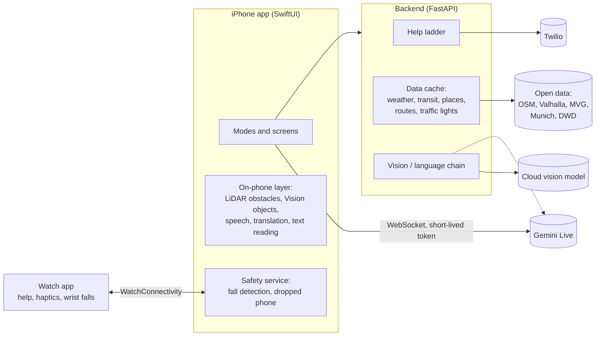

# Beistand

**One iPhone app that changes with what each person finds hard.** It is eyes for blind people,
ears for deaf people and a patient helper for older people. Underneath every mode sits one safety
layer: fall detection, a dropped-phone finder and a help ladder that reaches an emergency contact.

*Beistand* is German for "support", or "someone standing by you". I am building it in Munich for
hackaTUM 2026 (27–29 November 2026). Its open data comes from Munich, but most of it works anywhere.

> **Status:** early, working prototype (November 2026). Everything marked ✅ below runs on an
> iPhone and is covered by tests. Items marked 🧪 are verified on the simulator and have not yet
> been tried outdoors with real users. Features that need a cloud service fall back to an
> on-phone or rule-based version when no key is set, so the app never stops working.

---

## Who it is for

Sign-up asks **what is hard, never for a diagnosis**. The app talks from the first second, so a
blind person can sign up alone, or a relative can help. If the iPhone already has VoiceOver, very
large text, captions or Switch Control turned on, the matching modes switch on by themselves.

| Person | What Beistand does for them |
|---|---|
| **Older person** | A calm home screen with four big buttons: Call family, Where am I, Read this, Help. Letters are read aloud in simple words with the deadline first. Strange messages are checked for scams. A weather tip warns about ice and heat. |
| **Blind** | One button, "I'm lost", opens a camera guide that says where the person is, asks where to go and leads them by voice and vibration. The phone beeps like a parking sensor when something is in the way and names it ("Bike, 2 metres, left"). Routes prefer traffic lights with a sound signal for blind people. |
| **Low vision** | A live magnifier with real camera zoom, light, high-contrast and inverted colours, freeze, and "Explain", which reads the important text aloud with each word highlighted. |
| **Deaf or hard of hearing** | Sound alerts for sirens, doorbells and more (also on the watch), counter mode for talking at a desk, live captions of the people around them, where louder speech appears bigger and bolder, a loudness meter, a "loud sound nearby" warning, and on-phone translation. Alerts become light and vibration instead of speech. |
| **Wheelchair, walker, pram** | Step-free routes. |
| **Memory problems** | A bystander card on the alert screen ("I have memory problems, please call …"). |
| **Seizures** | Nothing in the app ever flashes; alert screens use steady colour. |
| **Everyone** | Fall detection with phone and watch, a help ladder that texts and calls the emergency contact with a live location page, a dropped-phone finder, a volume check, English or German following the phone. |

More modes cover speech, calm and easy reading, tremor, low energy and deafblindness.

---

## What works today

**Legend:** ✅ built and verified (tests plus simulator or iPhone) · 🧪 verified on simulator only ·
🔑 needs an API key to go beyond the fallback · 📝 planned.

### Safety layer (every mode)

| Feature | Status | Notes |
|---|---|---|
| Help ladder (ask → contact → emergency → resolved) | ✅ | Runs on the server, so it continues if the phone dies. |
| Texts and calls to the emergency contact | 🔑 | Twilio. Without keys, messages are shown at `/outbox` (dry run). |
| Live location page for the contact | ✅ | Only during an alert, behind a secret link, with "I'm taking care of it". |
| Fall detection (free fall → impact → stillness) | ✅ | Logic tested; real falls not staged. |
| Phone + watch decide fall vs dropped phone | 🧪 | |
| Dropped-phone finder (rising tone, "I'm here", slow torch) | ✅ | Never flashes in seizure mode. |
| 112 / nora (emergency app for deaf people) | ✅ | Only after a clear yes; iOS asks to confirm the call. |

### Modes and features

| Feature | Status | Notes |
|---|---|---|
| Spoken sign-up, voice or tap | ✅ | Skips questions the iPhone's accessibility settings already answer. |
| Read this (photo → simple words, deadline and amount first) | 🔑 | With a vision-model key: Easy Language. Without: on-phone text recognition, read word by word. |
| Scam check | ✅ / 🔑 | Offline rules for German and English scams always run; the model adds judgement with a key. Never says "safe". |
| Weather guard | ✅ | DWD warnings via Bright Sky. |
| "I'm lost" camera guide | ✅ / 🔑 | Spoken directions and haptics; with a Gemini key it becomes a live conversation. |
| Walking, wheelchair and blind-friendly routes | ✅ | OpenStreetMap Valhalla; OpenRouteService with a key. |
| Munich traffic lights with sound/touch signals | ✅ | City open data, announced about 25 m before each crossing. |
| Obstacle beeps (LiDAR) and named object warnings | 🧪 | Installed on an iPhone 16 Pro; first real walk pending. |
| Smart magnifier with "Explain" | ✅ / 🔑 | |
| Live captions sized by loudness, on-phone translation | ✅ / 🧪 | 14 languages with Apple's Translation framework (iOS 26+). |
| Watch app: help button, "Are you OK?", haptic directions | 🧪 | |
| English and German | ✅ | The server answers in the same language. |
| Sound alerts (siren, alarm, horn, doorbell, knock, baby, dog, shout) on phone and watch | 🧪 | On-phone SoundAnalysis: a big named card and a vibration pattern per sound. Simulated alert verified; real sounds pending. |
| Counter mode (phone flat between two people, staff side upside down) | ✅ / 🧪 | Captions of the staff, typed text shown and spoken; on-phone translation both ways on iOS 26. |
| Live street view ("Look around") | 🧪 | Compass strip, places floating in their real direction, the destination pin, live boxes for people, objects and signs; a spoken sweep ("Facing east. Ahead: …"). Works without any AI key. |
| Test drive: walk real streets from a desk | ✅ / 🔑 | Keys, arrows or on-screen sticks feed the guide's GPS, compass and camera, so route following, live view and sign reading run as outside. Mapillary or Street View pictures with a key. |
| Next-turn card and path markers in the live view | ✅ | Instruction, distance and an arrow that turns with the person. |
| Choose a destination on a map | ✅ | Search or drop a pin; an accessibility card (step-free, lifts, entrances, accessible toilets, tactile paving) from OpenStreetMap; "Take me there" starts the guide. |
| "What's in front of me?" without an AI key | ✅ | Compass, map, signs the phone reads and LiDAR; with a key the vision model gets the nearby places as facts. |
| Guide questions: "next departures", "where was the bench?" | ✅ | Live MVG departures and a 3-minute memory of what the camera recognised. |
| Accounts and family view (Supabase) | 📝 | Schema written (`supabase/schema.sql`), not wired yet. |
| Morning check-in, medicine taps, day anchor, way home, lift rerouting | 📝 | See [PLAN-ADVANCED.md](PLAN-ADVANCED.md). |

---

## How it works



- **The phone does the sensing and talking.** Camera, microphone, motion, location, speech, depth
  and object detection all run on the iPhone, most of it offline.
- **The backend does everything that needs keys, caching or a phone call:** the help ladder,
  Twilio, the vision model, the live-guide token and cached open data.
- **The live video guide skips the backend.** The phone connects to Gemini Live directly with a
  short-lived token from the server, because an extra hop adds delay.
- **The watch** reports wrist impacts and the help button, and turns directions and alerts into
  vibration patterns.

### Three speeds of seeing

| Layer | Runs on | Speed | Job |
|---|---|---|---|
| L1 | iPhone (LiDAR + Apple Vision) | every frame, < 100 ms | Warnings: obstacle beeps, "Bike, 2 metres, left". Fixed phrases, never generated, always interrupt. |
| L2 | Gemini Live | 1 picture/s + voice | Conversation and guidance, grounded by L1 events sent as text. |
| L3 | Cloud vision model | one picture | Careful reading: letters, labels, "what is this?". |

### Technology

| Part | Technology |
|---|---|
| iPhone app | SwiftUI, iOS 18+ (newer speech and translation on iOS 26+), project generated with [XcodeGen](https://github.com/yonaskolb/XcodeGen) |
| Watch app | watchOS 11+, SwiftUI, WatchConnectivity, CoreMotion |
| Backend | Python 3.11+, FastAPI, httpx |
| On-phone AI | Speech (SFSpeechRecognizer, SpeechAnalyzer), Translation, Vision, ARKit scene depth, SoundAnalysis |
| Cloud | A vision-language model for reading, Gemini Live for the live guide, Twilio for texts and calls |
| Accounts (planned) | Supabase (Postgres + Auth, row-level security) |

The full walkthrough of a day with the app, every component, the backend API and the testing
hooks are in [docs/HOW-IT-WORKS.md](docs/HOW-IT-WORKS.md).

---

## Run it

### Requirements

- A Mac with a current **Xcode** (built with the iOS 27 SDK; the app runs on iOS 18+)
- **XcodeGen**: `brew install xcodegen`
- **Python 3.11+** for the backend
- For a real iPhone: an Apple developer account (a free one works for your own phone). Obstacle
  beeps need an **iPhone Pro with LiDAR**; everything else works on any iPhone.
- Optional: an Apple Watch or a paired watch simulator

### 1. Backend

```bash
cd backend
python3 -m venv .venv
.venv/bin/pip install -r requirements.txt
cp .env.example .env            # optional: add keys, see below
.venv/bin/python -m uvicorn app.main:app --host 0.0.0.0 --port 8000 --reload
```

`curl localhost:8000/health` shows which features are live. `--host 0.0.0.0` lets a real iPhone on
the same Wi-Fi reach the Mac.

### 2. Keys (all optional)

A missing key switches that feature to its offline or dry-run version. `backend/.env.example`
lists them all.

| Key | Unlocks |
|---|---|
| `ANTHROPIC_API_KEY` | Read this in simple words, scam judgement, "What's in front of me?", magnifier "Explain" |
| `GEMINI_API_KEY` | Live camera guide; photo answers when there is no vision-model key |
| `TWILIO_ACCOUNT_SID`, `TWILIO_AUTH_TOKEN`, `TWILIO_FROM_NUMBER` | Real texts and calls to the emergency contact |
| `DB_CLIENT_ID`, `DB_API_KEY` | Lift status at stations (DB FaSta) |
| `ORS_API_KEY` | OpenRouteService routes (Valhalla is used without it) |
| `MAPILLARY_TOKEN` | Test drive in Mapillary's walking viewer |
| `GOOGLE_MAPS_API_KEY` | Test drive with Street View still pictures |
| `PUBLIC_BASE_URL` | The address the contact opens from the SMS; use a tunnel for a demo |

### 3. iPhone app in the simulator

```bash
cd ios
xcodegen generate
open Beistand.xcodeproj
```

The app talks to `http://localhost:8000` by default.

### 4. On a real iPhone

Select your team for the **Beistand** and **BeistandWatch** targets in Xcode (Signing &
Capabilities), run it, then point the app at your Mac in **Settings → Server**
(`ipconfig getifaddr en0` shows the Mac's address). Command-line install steps, the paired watch
simulator and launch options for testing are in [docs/HOW-IT-WORKS.md](docs/HOW-IT-WORKS.md#running-on-devices).

### Tests

```bash
cd backend && .venv/bin/python -m pytest -q          # 21 tests
cd ios && xcodegen generate && xcodebuild test -project Beistand.xcodeproj -scheme Beistand \
  -destination 'platform=iOS Simulator,name=iPhone 17 Pro'   # 38 tests
```

---

## Rules the app never breaks

The app helps people decide; it never takes the final safety decision for them.

- **Never says a street is safe to cross.** It describes what it sees and what the city data says
  about the signal, and leaves the choice to the person.
- **Cane and guide dog stay primary.** The guide works beside them, never instead.
- **No automatic call to 112.** Only after a clear yes, and iOS asks to confirm.
- **Warnings are never generated text.** Obstacle and crossing warnings are fixed, tested phrases.
- **Nothing flashes** faster than once per second, and nothing flashes at all in seizure mode.
- **Location is shared only during an alert**, through a secret link.
- **Video goes only to the guide;** nothing is stored.
- **Not a medical device.** Fall and seizure alerts are helpers, not certified safety equipment.

---

## Data sources and licences

| Source | Used for | Licence / terms |
|---|---|---|
| OpenStreetMap (via Valhalla, Overpass, Nominatim) | Routes, places, addresses | ODbL; fair-use limits on the public servers; results are cached |
| Valhalla public server (FOSSGIS) | Walking, wheelchair, blind routes | Fair use; set `VALHALLA_URL` to your own server for heavy use |
| Landeshauptstadt München, *Lichtsignalanlagen* | Traffic lights with signals for blind people | dl-de/by-2.0 |
| Bright Sky (DWD data) | Weather and warnings | DWD open data |
| MVG (unofficial API) | Stops and departures | Tolerated for moderate non-commercial use |
| DB FaSta | Lifts and escalators | DB API Marketplace terms |
| OpenRouteService | Routes (optional) | Free key with daily quota |
| Mapillary | Test-drive pictures (optional) | CC BY-SA |
| Google Street View Static API | Test-drive pictures (optional) | Google Maps Platform terms; recognition only for local testing |
| Cloud vision model, Gemini, Twilio | Reading, live guide, messages | Paid per use, per provider terms |

Credit OpenStreetMap contributors and the City of Munich wherever routes or crossings are shown.

---

## Roadmap

The detailed plan is in [PLAN-ADVANCED.md](PLAN-ADVANCED.md). In short: better perception (on-phone
detections grounding the live guide, sign and line-number reading), exact positioning (map
matching with step counting, optional RTK), a Munich accessibility map (kerbs, tactile paving,
lift status), more modes (sound alerts on the watch, morning check-in, medicine taps, way home),
accounts and a family view on Supabase, and tests with blind, deaf and older people before every
release.

## Contributing

Issues and pull requests are welcome, especially from people who use assistive technology every
day. Add a unit test for new logic, write every user-facing string as `tr("English", "Deutsch")`,
test with VoiceOver and the largest text size, and keep the rules above.

---

Idea, design and code: Christo Dontchev ([@Zukipany](https://github.com/Zukipany)).

## Licence

MIT, see [LICENSE](LICENSE). Data from OpenStreetMap (ODbL) and the City of Munich (dl-de/by-2.0)
keeps its own licence; credit both where it is shown.
