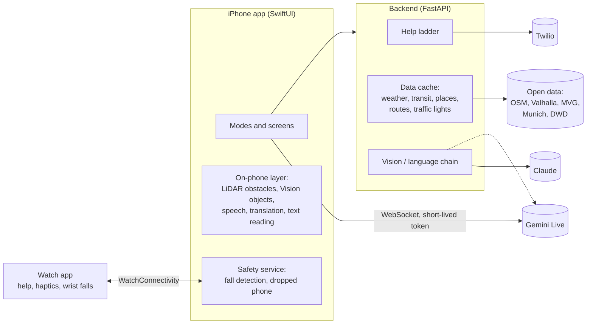

# Beistand

**One iPhone app that changes with what each person finds hard.** It acts as eyes for blind people, ears for deaf people and a patient helper for older people. More modes cover wheelchair users, memory loss, speech, calm and easy reading, seizures, tremor, low energy and deafblindness. One safety layer, with fall detection, a dropped-phone finder and a help ladder to an emergency contact, sits under every mode.

*Beistand* is German for "support" or "someone standing by you". The app is built in Munich for hackaTUM 2026 (27–29 November 2026), and its data sources are Munich's, but most of it works anywhere.

> **Status:** early, working prototype (November 2026). Everything listed as **built** below runs on an iPhone and is covered by tests; items marked **verified on simulator** have not yet been tried outdoors with real users. The AI features need API keys; without them the app falls back to on-phone or rule-based versions, so it never stops working.

---

## Contents

1. [What it does, by person](#1-what-it-does-by-person)
2. [Feature status](#2-feature-status)
3. [How it is built](#3-how-it-is-built)
4. [Repository layout](#4-repository-layout)
5. [Getting started](#5-getting-started)
6. [Walkthrough: one day with Beistand](#6-walkthrough-one-day-with-beistand)
7. [How each part works](#7-how-each-part-works)
8. [Backend API](#8-backend-api)
9. [Data sources and licences](#9-data-sources-and-licences)
10. [Testing](#10-testing)
11. [Safety, privacy and the rules the app never breaks](#11-safety-privacy-and-the-rules-the-app-never-breaks)
12. [Troubleshooting](#12-troubleshooting)
13. [Roadmap](#13-roadmap)
14. [Contributing](#14-contributing)

---

## 1. What it does, by person

Sign-up asks **what is hard, never for a diagnosis**. The app talks from the first second, so a blind person can sign up alone; a relative can also help. If the iPhone already has VoiceOver, very large text, captions or Switch Control turned on, the matching modes switch on by themselves and those questions are skipped.

| Person | What Beistand does for them |
|---|---|
| **Older person** | A calm home screen with four big buttons (Call family, Where am I, Read this, Help). Letters are read aloud in simple words with the deadline first. Strange messages are checked for scams. The weather tip warns about ice and heat. A fall starts the help ladder; a dropped phone calls out. |
| **Blind** | One button, "I'm lost", opens a camera guide that says where the person is, asks where to go, and leads them by voice and vibration. The phone beeps like a parking sensor when something is in the way and names what it is ("Bike, 2 metres, left"). Routes prefer traffic lights that have a sound signal for blind people, and the guide announces them. |
| **Low vision** | A live magnifier with real camera zoom, light, high-contrast and inverted colours, freeze, and "Explain", which reads the important text aloud with each word highlighted. |
| **Deaf or hard of hearing** | Sound alerts for sirens, doorbells and more (also on the watch), counter mode for talking at a desk, live captions of the people around them, where louder speech appears bigger and bolder, a loudness meter, a "loud sound nearby" warning, and on-phone translation when the other person speaks another language. Alerts become light and vibration instead of speech. |
| **Wheelchair, walker, pram** | Step-free routes (wheelchair profile). |
| **Memory problems** | A bystander card on the alert screen ("I have memory problems, please call …"); more is planned (day anchor, way home). |
| **Seizures** | Nothing in the app ever flashes; alert screens use steady colour. The bystander card explains what to do. |
| **Everyone** | Fall detection with phone and watch, a help ladder that texts and calls the emergency contact with a live location page, a dropped-phone finder, a volume check, English or German following the phone's language. |

---

## 2. Feature status

**Legend:** ✅ built and verified (tests plus simulator or iPhone) · 🧪 built, verified on simulator only · 🔑 built, needs an API key to go beyond the fallback · 📝 planned.

### Safety layer (every mode)

| Feature | Status | Notes |
|---|---|---|
| Help ladder (ask → contact → emergency → resolved) | ✅ | Server-side state machine, so it continues if the phone dies. |
| Texts and calls to the emergency contact | 🔑 | Twilio. Without keys, messages are shown at `/outbox` (dry run). |
| Live location page for the contact | ✅ | `/live/{id}?t=…`, only during an alert, with "I'm taking care of it". |
| Fall detection (phone: free fall → impact → stillness) | ✅ | Logic tested; real falls not staged. |
| Phone + watch decide fall vs dropped phone | 🧪 | Paired watch simulator: watch fall → phone and watch "Are you OK?". |
| Dropped-phone finder (rising tone, "I'm here", slow torch) | ✅ | Never flashes in seizure mode. |
| Resume an open alert after an app restart | ✅ | |
| 112 / nora (deaf users) | ✅ | Only after a clear yes; iOS asks to confirm the call. |

### Modes and features

| Feature | Status | Notes |
|---|---|---|
| Spoken sign-up, 7 questions, voice or tap | ✅ | Skips questions the iPhone's accessibility settings already answer. |
| Four-button home, long press explains each button | ✅ | |
| Read this (photo → simple words, deadline and amount first) | 🔑 | With a Claude key: simple language. Without: on-phone text recognition, word-by-word with highlighting. |
| Scam check | ✅ / 🔑 | Offline rules for German and English scams always run; Claude adds judgement with a key. Never says "safe". |
| Weather guard | ✅ | DWD warnings via Bright Sky. |
| "I'm lost" camera guide, simple mode | ✅ | Spoken directions, "What's in front of me?", haptic left/right. |
| "I'm lost" live guide (Gemini Live) | 🔑 | `gemini-3.8-live`, session resumption past the 2-minute camera limit. Not yet run against Gemini. |
| Walking, wheelchair and blind-friendly routes | ✅ | Free OpenStreetMap Valhalla server; OpenRouteService with a key. |
| Munich traffic lights with sound/touch signals on routes | ✅ | City open data; announced ~25 m before each crossing. Simulator walk verified. |
| Obstacle beeps (LiDAR) and named object warnings | 🧪 | Logic tested; installed on an iPhone 16 Pro, first real walk pending. |
| Smart magnifier with "Explain" | ✅ / 🔑 | Zoom, light, colours, freeze; explanation by Claude or on-phone reading. |
| Live captions sized by loudness | ✅ | Scripted demo verified; real microphone pending. |
| Newer on-device speech recognition (SpeechAnalyzer, iOS 26+) | 🧪 | Falls back to SFSpeechRecognizer. |
| On-device caption translation (14 languages) | 🧪 | iOS 26 Translation framework; not available in the simulator. |
| Watch app: help button, "Are you OK?", haptic directions | 🧪 | Paired simulator verified both directions. |
| Accessibility settings → modes, text size, contrast, volume check | ✅ | Tested at the largest text size with Increase Contrast. |
| English and German, following the phone | ✅ | Server answers in the same language. |
| Settings → "Try the app as …" (switch disabilities for testing) | ✅ | |
| Settings → Diagnostics (status and test button per feature) | ✅ | |
| Test-walk recorder and replay | ✅ | |
| Accounts and family view (Supabase) | 📝 | Schema written (`supabase/schema.sql`), not wired yet; profiles live in server memory. |
| Sound alerts (siren, alarm, horn, doorbell, knock, baby, dog, shout) on phone and watch | 🧪 | On-phone SoundAnalysis; big named card, vibration pattern per sound, watch tap. Also inside live captions. Simulated alert verified; real sounds pending. |
| Counter mode (phone flat between two people, staff side upside down) | ✅ / 🧪 | Captions of the staff, typed text shown and spoken; on-phone translation both ways on iOS 26. |
| Guide asks: "next departures", "where was the bench?" | ✅ | Live MVG departures (also a button in simple mode); a 3-minute memory of what the camera recognised. |
| Morning check-in, medicine taps, day anchor, way home, lift rerouting | 📝 | See [PLAN-ADVANCED.md](PLAN-ADVANCED.md). |

---

## 3. How it is built



- **The phone does the sensing and talking.** Camera, microphone, motion, location, speech, depth and object detection all run on the iPhone, most of it offline.
- **The backend does everything that needs keys, caching or a phone call**: the help ladder, Twilio, Claude, the Gemini token, and cached open data.
- **The live video guide skips the backend**: the phone connects to Gemini Live directly over a WebSocket with a short-lived token from the server, because an extra hop adds delay.
- **The watch** reports wrist impacts and the help button, and turns directions and alerts into vibration patterns.

### Three speeds of seeing

| Layer | Runs on | Speed | Job |
|---|---|---|---|
| L1 | iPhone (LiDAR + Apple Vision) | every frame, < 100 ms | Warnings: obstacle beeps, "Bike, 2 metres, left". Fixed phrases, never generated, always interrupt. |
| L2 | Gemini Live | 1 picture/s + voice | Conversation and guidance, grounded by L1 events sent as text. |
| L3 | Claude | one picture | Careful reading: letters, labels, "what is this?". |

### Technology

| Part | Technology |
|---|---|
| iPhone app | Swift 5 mode, SwiftUI, iOS 18+ (newer speech and translation on iOS 26+), generated with [XcodeGen](https://github.com/yonaskolb/XcodeGen) |
| Watch app | watchOS 11+, SwiftUI, WatchConnectivity, CoreMotion |
| Backend | Python 3.11+, FastAPI, httpx, the official `anthropic` SDK |
| On-phone AI | Speech (SFSpeechRecognizer, SpeechAnalyzer), Translation, Vision, ARKit scene depth, SoundAnalysis |
| Cloud AI | Claude Opus 5.5 (vision and language), Gemini Live (`gemini-3.8-live`) |
| Accounts (planned) | Supabase (Postgres + Auth, row-level security) |

---

## 4. Repository layout

```
beistand/
├── README.md                 ← you are here
├── PLAN-ADVANCED.md          ← the detailed plan: perception, positioning, Munich map, schedule
├── PROGRESS.md               ← developer log: what is done, verified, and how to resume
├── backend/
│   ├── app/
│   │   ├── main.py           ← all HTTP endpoints, the contact's live page
│   │   ├── ladder.py         ← help ladder state machine (time is injected → testable)
│   │   ├── notifier.py       ← Twilio calls/SMS, or a dry-run log
│   │   ├── llm.py            ← vision/language chain (Claude → Gemini), Read this, scam rules
│   │   ├── guide.py          ← guide prompts (EN/DE), tools, place search, one-photo describe
│   │   ├── crossings.py      ← Munich traffic lights with signals for blind people
│   │   ├── data.py           ← cache, weather, transit, lifts, places, routes (Valhalla, ORS)
│   │   ├── lang.py           ← English/German helper
│   │   └── config.py         ← settings from environment / .env
│   ├── tests/test_backend.py ← 21 tests
│   ├── requirements.txt
│   └── .env.example          ← every key, what it unlocks, where to get it
├── ios/
│   ├── project.yml           ← XcodeGen spec (app, watch app, tests)
│   ├── Beistand/
│   │   ├── App/              ← app entry, App Intents (Action Button, Siri)
│   │   ├── Core/             ← profile store, API client, speech, location, volume,
│   │   │                        accessibility detection, newer speech engine, walk recorder
│   │   ├── Features/         ← onboarding, home, Read this, scam check, magnifier,
│   │   │                        live captions, read-aloud, diagnostics, scaled fonts
│   │   ├── Guide/            ← "I'm lost": controller, Gemini Live protocol and media,
│   │   │                        route follower, LiDAR camera, obstacles
│   │   ├── Safety/           ← fall detection, dropped-phone finder, help ladder client,
│   │   │                        alert screens, watch link
│   │   └── de.lproj/         ← German permission texts
│   ├── BeistandWatch/        ← watch app
│   ├── Shared/               ← code used by phone and watch (messages, wrist fall, language)
│   └── BeistandTests/        ← 38 tests
└── supabase/schema.sql       ← accounts, modes, contacts, consents, events, medicines (RLS)
```

---

## 5. Getting started

### 5.1 Requirements

- A Mac with a current **Xcode** (developed with the iOS 27 SDK; the app runs on iOS 18+).
- **XcodeGen**: `brew install xcodegen`
- **Python 3.11+** for the backend.
- For a real iPhone: an Apple developer account (a free one works for your own phone). An **iPhone Pro with LiDAR** is needed for obstacle beeps; everything else works on any iPhone.
- Optional: an Apple Watch, or a paired watch simulator.

### 5.2 Backend

```bash
cd backend
python3 -m venv .venv
.venv/bin/pip install -r requirements.txt
cp .env.example .env            # optional: add keys, see below
.venv/bin/python -m uvicorn app.main:app --host 0.0.0.0 --port 8000 --reload
```

Check it: `curl localhost:8000/health` shows which features are live, for example:

```json
{"ok": true, "twilio": false, "llm": false, "gemini": false, "gemini_model": "gemini-3.8-live",
 "routes": "valhalla", "vision": ["offline"], "lifts": false}
```

`--host 0.0.0.0` lets a real iPhone on the same Wi-Fi reach the Mac.

### 5.3 API keys (all optional)

Every key is optional: a missing key switches that feature to an offline or dry-run version. `backend/.env.example` lists them all.

| Key | Unlocks | Where |
|---|---|---|
| `ANTHROPIC_API_KEY` | Read this in simple words, scam judgement, "What's in front of me?", magnifier "Explain" | [platform.claude.com](https://platform.claude.com) |
| `GEMINI_API_KEY` | Live camera guide; photo answers when there is no Claude key | [aistudio.google.com/apikey](https://aistudio.google.com/apikey) |
| `TWILIO_ACCOUNT_SID`, `TWILIO_AUTH_TOKEN`, `TWILIO_FROM_NUMBER` | Real texts and calls to the emergency contact | [console.twilio.com](https://console.twilio.com) |
| `DB_CLIENT_ID`, `DB_API_KEY` | Lift status at stations (DB FaSta) | [developers.deutschebahn.com](https://developers.deutschebahn.com) |
| `ORS_API_KEY` | OpenRouteService routes (Valhalla is used without it) | [openrouteservice.org](https://openrouteservice.org) |
| `PUBLIC_BASE_URL` | The address the contact opens from the SMS; use a tunnel (ngrok, Cloudflare) for a demo | – |

Model names are settings, too: `ANTHROPIC_MODEL` (default `claude-opus-5-5`), `GEMINI_LIVE_MODEL` (default `gemini-3.8-live`), `GEMINI_VISION_MODEL`.

### 5.4 iPhone app in the simulator

```bash
cd ios
xcodegen generate
open Beistand.xcodeproj           # or build from the command line:
xcodebuild -project Beistand.xcodeproj -scheme Beistand \
  -destination 'platform=iOS Simulator,name=iPhone 17 Pro' -derivedDataPath build build
```

The app talks to `http://localhost:8000` by default.

### 5.5 iPhone app on a real iPhone

1. In Xcode, select the **Beistand** target → Signing & Capabilities → your team. Do the same for **BeistandWatch**. Or pass the team on the command line:

   ```bash
   xcodebuild -project Beistand.xcodeproj -scheme Beistand \
     -destination 'id=<your-iphone-udid>' -derivedDataPath build-device \
     -allowProvisioningUpdates DEVELOPMENT_TEAM=<your-team-id> build
   xcrun devicectl device install app --device <udid> build-device/Build/Products/Debug-iphoneos/Beistand.app
   ```

2. Tell the app where the Mac is (same Wi-Fi):

   ```bash
   xcrun devicectl device process launch --device <udid> --terminate-existing app.beistand.ios \
     -backendURL http://<your-mac-ip>:8000
   ```

   The app remembers the address. You can also change it in Settings → Server. Find the Mac's address with `ipconfig getifaddr en0`.

3. If the phone shows as "unavailable" in `xcrun devicectl list devices`, unlock it and wait a few seconds.

### 5.6 Watch app in a paired simulator

```bash
xcrun simctl create "Beistand Watch" com.apple.CoreSimulator.SimDeviceType.Apple-Watch-SE-3-44mm \
  com.apple.CoreSimulator.SimRuntime.watchOS-27-0
xcrun simctl pair <watch-udid> <iphone-sim-udid>
xcrun simctl boot <watch-udid>
xcrun simctl install <watch-udid> ios/build/Build/Products/Debug-watchsimulator/BeistandWatch.app
xcrun simctl launch <watch-udid> app.beistand.ios.watchkitapp
```

(If the watch runtime is missing: `xcodebuild -downloadPlatform watchOS`.)

---

## 6. Walkthrough: one day with Beistand

This follows the demo story from the plan. Each step says what the person does, what the app does, and which code does it.

### 6.1 Signing up (Maria, 78, has trouble reading small print)

1. Maria opens the app. It speaks at once: *"Welcome to Beistand. I can see: very large text is on. I'll set the app up to match. … What is your name?"* She says "Maria" or types it.
   *Code:* `Features/OnboardingView.swift`, `Core/SystemAccessibility.swift` (reads VoiceOver, text size, captions, mono audio, Switch Control, AssistiveTouch).
2. The question "Can you read this text?" is skipped, because her iPhone settings already answered it (low-vision mode is on). The counter says "Question 1 of 6".
3. "Can you hear this tone?" waits until the volume is at least half, so a quiet phone isn't mistaken for hearing loss. A yellow banner says *"Your phone is quiet. Press the volume-up button on the left side."* (`Core/Volume.swift`).
4. She answers the other questions by voice ("yes", "no"; whole words only, so "I know" is not "no") or by tapping. Silence on the reading question would have meant blind mode.
5. Her daughter Anna types her own number as the emergency contact.
   The profile is saved on the phone and sent to the server (`PUT /users/{id}/profile`).

### 6.2 The home screen

Four big buttons, at least 88 points tall, that grow with the iPhone's text size; at the largest sizes the icon moves above the words. Button colours are dark enough for white text (at least 4.5:1); with Increase Contrast they get an outline. A long press reads out what a button does. Taps within 0.8 s of each other are ignored (tremor).

Above the buttons: the day's weather tip (*"It may be icy today. Wear sturdy shoes or wait until midday."*), from official DWD warnings.

### 6.3 A letter arrives

Maria taps **Read this** and photographs the letter.

- **With a Claude key:** the server sends the photo to Claude Opus 5.5 with a prompt that asks for Easy Language, the action and the deadline first, and a scam warning when something looks wrong. The answer comes back as JSON (sender, what they want, amount, deadline, spoken text). Code: `backend/app/llm.py` → `read_letter`.
- **Without a key, or offline:** the phone reads the text itself with Apple Vision, finds the first amount and date, and reads everything out. Code: `Features/ReadAloud.swift` → `OnDeviceReader`.

Either way, the text is shown large and **each word is highlighted as it is spoken**, and one button sends it to Anna by SMS.

### 6.4 A strange message

*"Hi mum, this is my new number. Can you transfer 900 pounds today?"* Maria taps **Is this a scam?** and pastes it.

The offline rules (`SCAM_PATTERNS` in `llm.py`: new number, fake police, fake bank, fake parcel, urgent payment, gift cards, prize, shock call, in German and English) flag it as **likely scam**. With a key, Claude adds its judgement, but the rules can only raise the warning level, never lower it. The answer never says a message is safe: *"This looks like a scam. Someone is pretending to be your child or grandchild with a new number. Don't pay anything. Call the person or company on the number you already know."*

### 6.5 Going for a walk

Maria's grandson set the app to show the **I'm lost** button (Settings → "Try the app as … Low vision"). She presses it, or the Action Button, or says "I'm lost with Beistand" to Siri.

1. The guide says where she is: *"You are here: Sendlinger-Tor-Platz 11, Altstadt-Lehel."* (reverse geocoding on the phone).
2. *"Where would you like to go?"* She says "Hauptbahnhof". The server finds the place near her (`/geocode`, OpenStreetMap Nominatim, cached for a week).
3. The server plans a route (`/route`): OpenRouteService if there is a key, else the free Valhalla server, else a straight line with distance and direction so the guide never has nothing. For blind users it asks Valhalla for alternatives and picks the one with the most crossings that have a **sound signal for blind people**, as long as it is at most 15 % longer (`crossings.best_for_blind`).
4. While she walks, `Guide/RouteFollower.swift` compares each GPS fix with the route:
   - about 15 m before each turn it speaks the instruction and vibrates (2 pulses left, 3 right; on the watch too);
   - about 25 m before each traffic light it says *"Traffic light crossing ahead, with a sound and touch signal."*: never whether it is safe;
   - more than 25 m off the route (twice in a row, allowing for GPS error) it re-plans and says so calmly; after three re-plans it offers to call Anna;
   - within 10 m of the goal: *"You have arrived: Munich Central Station."*
5. **With a Gemini key** the same walk becomes a conversation: the camera sends one picture per second, the microphone streams, and Gemini answers by voice. The route, the position and every warning from the phone are sent to Gemini as `[CONTEXT]` text. When Gemini announces it will close the connection (camera sessions are limited to about 2 minutes), the app reconnects with a resume handle and the conversation continues (`ResumePolicy`).
6. **On an iPhone Pro**, the camera is ARKit with LiDAR depth. A parking-sensor beep speeds up as something gets closer in an 80 cm lane straight ahead (silent beyond 2 m, fastest under 0.5 m), ignoring the ground and anything above head height. Apple Vision finds people and prominent objects; the phone says *"Scooter, 2 metres, ahead."* These warnings are fixed phrases and interrupt the guide.

### 6.6 She drops the phone

The phone feels free fall, a hard impact, then stillness. The watch felt no impact on the wrist, so it is probably a dropped phone, not a fall. After about 20 seconds without a pickup, the **phone finder** starts: a loud rising tone (it plays even in silent mode), *"I'm here"* every few seconds, a white screen and a slowly pulsing torch (at most once per second, and never flashing in seizure mode). Picking it up stops it.

### 6.7 She falls

This time the watch also feels a hard hit, then a still arm for 10 seconds (`Shared/WristFall.swift`). The phone and the watch agree: probably a fall.

1. **Ask:** the phone says *"Are you OK? Tap: I'm OK. Otherwise I'll call for help in 30 seconds."*; the watch vibrates and shows the same. Deaf users get a pulsing yellow screen instead of speech (steady in seizure mode).
2. **Contact:** after 30 s without an answer, the server texts and calls Anna through Twilio with a live location link. The call says the message twice, in Maria's language. If Anna doesn't respond, it tries again and then everyone on the list (up to 3 rounds).
3. **Anna** opens the link: a simple page with the location on a map and an "I'm taking care of it" button. Maria's phone then says *"Anna is taking care of you."*
4. **Emergency:** only after a clear yes from Maria or Anna does the phone offer 112 (iOS asks to confirm the call), or nora, the official emergency app for deaf people.
5. **Bystanders:** the alert screen shows a card: *"Maria may need help. Please call Anna: +49 …"*, with what to do for a seizure, or "I have memory problems", when those modes are on.
6. Maria taps **I'm OK** at any point: everything stops, and Anna gets an all-clear text.

The ladder runs **on the server** (`backend/app/ladder.py`), so it continues if the phone breaks or loses power. The app picks an open alert back up after a restart.

### 6.8 At the station: hearing mode

Her neighbour Ali is hard of hearing. In Live captions, what people around him say appears as large text; **louder speech is bigger and bolder**, so he can tell a shout from a whisper. A meter shows the loudness (*"≈ 68 dB · normal voice"*), and a horn or a shout without words shows *"Loud sound nearby"* and vibrates. A tourist asks him something in Turkish: he picks "They speak: Turkish", and each line is translated on the phone into his language, large, with the original small underneath.

---

## 7. How each part works

### 7.1 Language

`ios/Shared/Lang.swift` holds one helper, `tr("English", "Deutsch")`: the app is in German when the phone's first language is German, otherwise in English. Every user-facing string, every spoken sentence, speech recognition, voices, Gemini's voice language and every server request (`lang=en|de`) follow it. On the server, `backend/app/lang.py` does the same; guide prompts exist in both languages. The emergency contact gets texts and calls in the person's language. Force a language for testing with the launch argument `-lang de`.

### 7.2 Profile, modes and accessibility

- `Core/AppStore.swift`: the profile (name, modes, contacts), persisted on the phone and synced to the server. 13 modes: older, dementia, sight, low vision, hearing, wheelchair, speech, calm, easy reading, seizure, tremor, low energy, deafblind.
- `Core/SystemAccessibility.swift`: maps iPhone settings to modes (pure function `hints(_:)`, unit-tested). A setting switched on later adds its mode once; turning it off never removes a mode.
- `Features/Scaled.swift`: `scaledFont` (big text that follows Dynamic Type, growth capped), `A11yColor` (button colours ≥ 4.5:1 with white), `FitScroll` (screens scroll only when large text needs it).
- Settings → **Try the app as …** replaces all modes at once (older person, blind, low vision, deaf, memory, wheelchair, seizures, deafblind); below it, one switch per mode.

### 7.3 Speech in and out

- `Core/Speaker.swift`: AVSpeechSynthesizer on its own queue (the first voice lookup can block for seconds; on the main thread it froze the app), slower rate for older users, a timeout so follow-up actions still happen if speech stalls, and word-by-word callbacks for highlighting.
- `Core/Listener.swift`: short answers ("yes", "no", a name) with on-device recognition; `yesNo` matches whole words in both languages.
- `Core/ModernSpeech.swift`: SpeechAnalyzer + SpeechTranscriber on iOS 26+: long-form, on device, punctuation, and the audio time of every word. The language model downloads once.

### 7.4 Safety service

- `Safety/FallDetector.swift`: `FallPattern` (free fall < 0.35 g for ≥ 80 ms → impact > 2.5 g within 1 s → 10 s within ±0.12 g of rest), fed by CoreMotion at 50 Hz.
- `Safety/SafetyService.swift`: decides fall vs dropped phone (watch confirmation, or the demo switch "A phone fall counts as a fall of the person"), drives the server ladder, polls it every 2 s, keeps sending the location, resumes after a restart, falls back to dialling the contact directly if the server is unreachable.
- `Safety/DropFinder.swift`: tone, voice, torch, screen.
- `Safety/IncidentViews.swift`: the countdown, emergency and bystander screens.
- `backend/app/ladder.py`: `Ladder.start / person_ok / contact_ack / confirm_emergency / resolve / tick`. Time is passed in, so the tests run a whole incident in milliseconds. Explicit triggers (help button, spoken help, lost) skip the "Are you OK?" step.

### 7.5 Watch

- `ios/Shared/WatchMessage.swift`: everything phone and watch say to each other, as plist dictionaries (help, I'm OK, wrist impact, wrist fall, guide cues; the incident state as application context, so a sleeping watch catches up).
- `ios/Shared/WristFall.swift`: hit > 3 g, then an arm still for 10 s → fall; moving on or clapping → no fall; at most one impact report per 2 s.
- `BeistandWatch/`: hold-1-second Help button (a brushed sleeve doesn't call for help), "Are you OK?", "Help is coming. Calling Anna.", 112 button, and an offline fallback that offers the calls itself when the phone is out of reach. Haptics: left = 2 taps, right = 3, arrived = success, asking = repeated until answered.
- `Safety/WatchLink.swift`: the phone side.

### 7.6 The camera guide ("I'm lost")

- `Guide/GuideController.swift`: starts in Live mode if the server has a Gemini key, else simple mode; plans routes, follows them, runs the guide's tools (`plan_route`, `crossing_info`, `call_emergency_contact` (only after a clear yes)), sends `[CONTEXT]` updates, shows captions (newest on top, large, also for deaf companions).
- `Guide/LiveProtocol.swift`: Gemini Live messages (setup with session resumption and sliding-window compression, audio, video, text, tool responses, parsing incl. `goAway` and `sessionResumptionUpdate`), and `ResumePolicy` (reconnect up to 5 times in a row).
- `Guide/LiveMedia.swift`: 16 kHz microphone in, 24 kHz voice out with echo cancellation, and the WebSocket client, which ignores late events from a replaced connection.
- `Guide/RouteFollower.swift`: geometry and the step/crossing/off-route/arrival logic (pure, tested with simulated walks).
- `backend/app/guide.py`: system prompts (sight and low vision, English and German) with the safety rules, tools, place search, one-photo description and magnifier explanation.

### 7.7 Obstacles and objects (iPhone Pro)

- `Guide/GuideCamera.swift`: on LiDAR phones, ARKit with scene depth and horizontal planes: a JPEG per second for the guide, obstacle lanes ~10 times per second, objects ~2 times per second. Other phones use the plain camera.
- `Guide/Obstacles.swift`:
  - `ObstacleGeometry`: depth pixels → world points (camera intrinsics scaled to the depth image) → three lanes in the walking direction; ignores the floor (ARKit's lowest plane) and anything above 2 m.
  - `BeepTiming`: silent > 2 m, 0.7 s … 0.1 s between beeps.
  - `ObjectAlerts`: what to say, nearest in the path first, people only within 1.5 m, no repeat within 8 s, 2 s between warnings.
  - `Beeper`: 1.4 kHz click plus haptic; haptic only for deaf users.
- Objects come from Apple Vision (human detector, objectness boxes, image classifier on each box), so there are no model licence issues.

### 7.8 Maps and routes

- `backend/app/data.py`: `valhalla_route` (pedestrian costing types foot / wheelchair / blind, steps penalised for walkers, polyline6 decoding, alternatives for blind users, cached 6 h), `route` (OpenRouteService), `direct_route` (straight line), `nearby` (benches, toilets, wheelchair toilets, pharmacies, doctors, disabled parking from Overpass), MVG stations and departures, DB FaSta lifts, Bright Sky weather with a tip in the person's language.
- `backend/app/crossings.py`: the city's traffic lights (1,186 in the data, 1,160 still in service; 683 have a sound + touch signal for blind people, 244 touch only), loaded daily; which lie within 15 m of a route and how far along; the spoken sentence; the blind route choice.

### 7.9 Hearing: live captions and translation

`Features/LiveCaptions.swift`:
- The microphone runs in measurement mode (no automatic gain, so loud really reads as loud).
- Each word's loudness is the power average of the microphone level over the time the word was spoken (`Loudness.average`), mapped to 18–60 pt and three font weights.
- The newer engine settles words with final results and shows guesses with volatile ones; a 1.5 s pause starts a new line.
- With "They speak: …", recognition runs in that language and each line is translated with Apple's on-device Translation framework.

### 7.10 Low vision: magnifier and read-aloud

`Features/Magnifier.swift` (camera zoom via `videoZoomFactor`, torch, Core Image colour modes, freeze, "Explain") and `Features/ReadAloud.swift` (`ReadAloudText` with word highlighting, `OnDeviceReader` with amount and date extraction).

### 7.11 Diagnostics and testing hooks

`Features/Diagnostics.swift` shows: server reachability, whether contact messages are real or a dry run, the vision model chain, the live guide state and reconnect count, LiDAR, the router, the speech engine, translation, the watch connection. Test buttons: read a sample label, plan Sendlinger Tor → Hauptbahnhof with your profile, list traffic lights near Hauptbahnhof, scam check, speak a sentence, tap "turn left" on the watch. It also switches the walk recorder on and shares recorded walks.

---

## 8. Backend API

All endpoints accept `lang=en|de` where text comes back. Live data comes wrapped as `{"data": …, "fetched_at", "age_s", "stale"}`, so the app can show how old it is.

| Method and path | What it does |
|---|---|
| `GET /health` | Which features are live: Twilio, LLM, Gemini (+ model), router, vision chain, lifts. |
| `PUT /users/{id}/profile` · `GET …` | Save / read a profile (name, language, modes, contacts in E.164). |
| `POST /incidents` | Start the help ladder: `{user_id, trigger, location?}`. Triggers: `fall`, `help_button`, `spoken_help`, `lost`, `no_sign_of_life`, `long_shaking`. |
| `GET /incidents/{id}` | Current state, deadline, who acknowledged. |
| `POST /incidents/{id}/ok` · `/ack` · `/confirm-emergency` · `/resolve` · `/location` | The person is OK · a contact takes care · emergency confirmed · close · new position. |
| `GET /live/{id}?t=…` · `GET /live/{id}/ack?t=…&name=…` | The contact's page (map link, history, "I'm taking care of it"), only with the secret token, only during the alert. |
| `GET /outbox` | Texts and calls that were sent (or would have been, in dry run). |
| `POST /read` | Photo → `{readable, retake_hint, sender, wants, amount, deadline, spoken}`. |
| `POST /scam-check` | Text → `{level: likely_scam / suspicious / unclear, patterns, spoken, source}`. Never "safe". |
| `POST /gemini/token` | Short-lived Gemini Live token + model for the phone. |
| `GET /warnings?lat&lon` | Weather, official warnings, one-sentence tip. |
| `GET /stations?lat&lon` · `GET /departures?global_id` | MVG stops and live departures. |
| `GET /lifts?station_number` | Lift and escalator status (DB FaSta). |
| `GET /nearby?lat&lon&kind&radius_m` | Benches, toilets, wheelchair toilets, pharmacies, doctors, disabled parking. |
| `GET /route?from_lat&from_lon&to_lat&to_lon&profile` | `profile`: `foot-walking`, `wheelchair`, `blind`. Steps, geometry, `crossings`, `provider`, `alternatives_checked`. |
| `GET /crossings?lat&lon&radius_m` | Nearest traffic lights with their signal. |
| `GET /guide/prompt?mode` | Guide system prompt, tools and voice language (`mode`: `sight`, `low_vision`). |
| `GET /geocode?q&lat&lon` | Places near the person. |
| `POST /describe` | One photo → short spoken description (`purpose`: `lost` or `magnify`). |

---

## 9. Data sources and licences

| Source | Used for | Licence / terms |
|---|---|---|
| OpenStreetMap (via Valhalla, Overpass, Nominatim) | Routes, places, addresses | ODbL; fair-use limits on the public servers; results are cached |
| Valhalla public server (FOSSGIS) | Walking, wheelchair, blind routes | Fair use; set `VALHALLA_URL` to your own server for heavy use |
| Landeshauptstadt München, *Lichtsignalanlagen* | Traffic lights with signals for blind people | dl-de/by-2.0 |
| Bright Sky (DWD data) | Weather and warnings | DWD open data |
| MVG (unofficial API) | Stops and departures | Tolerated for moderate non-commercial use; may stop |
| DB FaSta | Lifts and escalators | DB API Marketplace terms |
| OpenRouteService | Routes (optional) | Free key with daily quota |
| Claude, Gemini, Twilio | AI and messages | Paid per use, per provider terms |

Credit OpenStreetMap contributors and the City of Munich wherever routes or crossings are shown.

---

## 10. Testing

```bash
# backend: 21 tests (ladder, notifier, scam rules in two languages, weather, API flow,
# guide prompts, routes and fallbacks, Valhalla parsing, crossings, blind route choice)
cd backend && .venv/bin/python -m pytest -q

# iPhone app: 38 tests (route following and crossings, Gemini Live messages and resumption,
# watch messages and wrist falls, accessibility mapping, languages, yes/no, text extraction,
# loudness and caption timing, obstacle geometry, beep timing, warning rules, walk replay)
cd ios && xcodegen generate && xcodebuild test -project Beistand.xcodeproj -scheme Beistand \
  -destination 'platform=iOS Simulator,name=iPhone 17 Pro'
```

### Launch options for testing (debug builds)

Pass them after the bundle id: `xcrun simctl launch <device> app.beistand.ios -openGuide YES`.

| Option | Effect |
|---|---|
| `-backendURL http://…:8000` | Server address (remembered) |
| `-lang de` | Force German (or `en`) |
| `-openGuide YES -guideDestination Odeonsplatz` | Open "I'm lost" and go to a place after 4 s |
| `-openMagnifier YES` | Open the magnifier (simulator shows a test medicine label) |
| `-openCaptions YES -demoCaptions YES` | Live captions with a scripted conversation at different volumes |
| `-openDiagnostics YES` | Open Diagnostics |
| `-openSounds YES -testSound siren` | Open sound alerts and raise a test alert after 2 s |
| `-openCounter YES` | Open counter mode |
| `-fakeVolume 0.2` | Pretend the phone is quiet |
| Watch: `-watchAction ok\|help\|fall` | The watch presses that button 3 s after connecting |

### Simulated walks

Get a route from the server, cut it into ~10 m waypoints, and let the simulator walk it:

```bash
xcrun simctl location <device> start --speed=4 48.134,11.5671 48.1341,11.5670 …
```

Give it many waypoints: with only start and end, the simulator walks a curve and the app (correctly) reports that the person left the route.

### Recorded walks

Settings → Diagnostics → **Record test walks**. Each walk is saved as JSON lines (GPS fixes, obstacle lanes, detected objects, everything the phone said), shareable from Diagnostics, and readable with `WalkRecorder.read`, so a real walk can be replayed through the warning rules in a unit test (`testReplayRecordedWalk`).

---

## 11. Safety, privacy and the rules the app never breaks

The app helps people decide; it never takes the final safety decision for them.

- **Never says a street is safe to cross.** It describes what it sees and what the city data says about the signal ("the light shows green", "with a sound signal"), and leaves the choice to the person. This rule is in every guide prompt and in every fixed phrase.
- **Cane and guide dog stay primary.** The guide works beside them, never instead.
- **No automatic call to 112.** Only after a clear yes from the person or the contact, and iOS asks to confirm.
- **Warnings are never generated text.** Obstacle and crossing warnings are fixed, tested phrases; a language model never replaces a warning.
- **Nothing flashes** faster than once per second, and nothing flashes at all in seizure mode.
- **Location is shared only during an alert**, through a secret link, and the page stops showing it when the alert ends.
- **Video goes only to the guide**; nothing is stored. Recorded test walks contain no pictures or audio and stay on the phone until shared.
- **Sign-up asks what is hard, not for a diagnosis.**
- **Not a medical device.** Fall and seizure alerts are helpers, not certified safety equipment.
- **Data can be wrong or late**: lifts, departures and warnings show their age.

---

## 12. Troubleshooting

| Problem | Fix |
|---|---|
| The iPhone can't reach the server | Same Wi-Fi as the Mac; server started with `--host 0.0.0.0`; correct address in Settings → Server (`ipconfig getifaddr en0` on the Mac). |
| `No module named uvicorn` | Run the server with `backend/.venv/bin/python`, not the system `python3`. |
| Phone "unavailable" for `devicectl` | Unlock it, keep it plugged in, wait a few seconds. |
| Live guide stays in "Simple mode" | `GEMINI_API_KEY` missing, or the model name is wrong; check `/health` and the Models page. |
| Read this only reads word for word | No `ANTHROPIC_API_KEY`: that's the offline fallback. |
| No obstacle beeps | Needs an iPhone with LiDAR; Diagnostics → "LiDAR depth" must say yes; Settings → obstacle warnings on. |
| Translation "not available" | Needs iOS 26 on a real device; download the language pack once from Live captions. |
| Speech engine shows SFSpeechRecognizer | Normal in the simulator and below iOS 26. |
| Simulated walk says "off route" | Give `simctl location start` many waypoints along the route. |

---

## 13. Roadmap

The full plan, with sources, is in [PLAN-ADVANCED.md](PLAN-ADVANCED.md). In short:

1. **Perception:** grounding Gemini with on-phone detections, live sign and line-number reading, pedestrian light state (described, never judged).
2. **Positioning:** map matching with step counting (no hardware), Apple geo tracking where available, an optional survey-grade RTK kit using the Bavarian SAPOS corrections.
3. **Munich accessibility map:** our own routing graph with traffic-light signals, kerbs, tactile paving, Mapillary crossings, lift status, parked scooters, noise maps.
4. **Modes:** sound alerts on the watch, counter mode, morning check-in, medicine taps, day anchor, way home, lift rerouting, transport helper.
5. **Accounts and family view** on Supabase, a GDPR impact assessment, EU hosting.
6. **Real users:** tests with blind, deaf and older people (for example through BBSB and senior centres) before every release.

---

## 14. Contributing

Issues and pull requests are welcome, especially from people who use assistive technology every day. When you add a feature:

- add a unit test for its logic and, where it makes sense, a Diagnostics row with a test button;
- write every user-facing string as `tr("English", "Deutsch")`;
- test with VoiceOver and the largest text size;
- keep the rules in [section 11](#11-safety-privacy-and-the-rules-the-app-never-breaks).

Author: Christo Dontchev ([@Zukipany](https://github.com/Zukipany)).

## Licence

MIT, see [LICENSE](LICENSE). Data from OpenStreetMap (ODbL) and the City of Munich (dl-de/by-2.0) keeps its own licence; credit both where it is shown.
